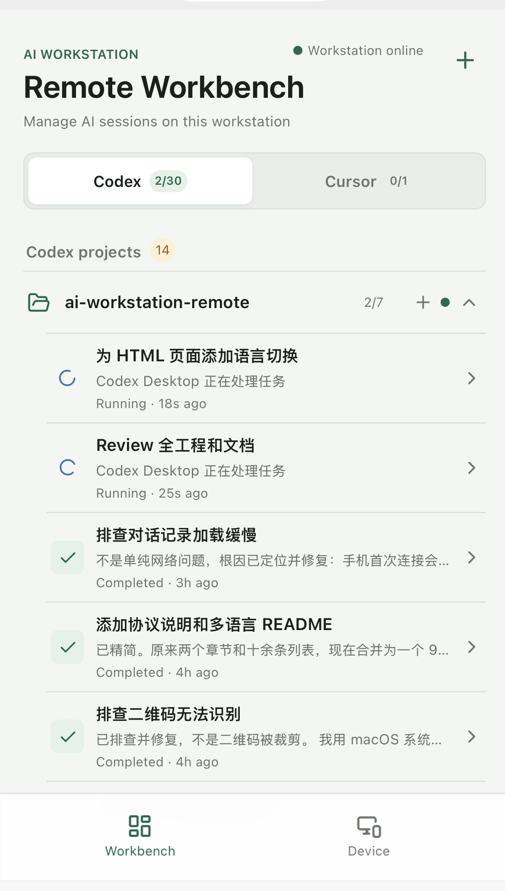
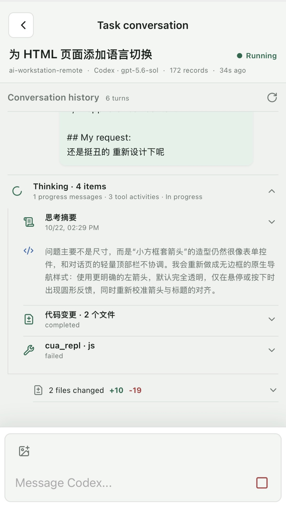

<div align="center">

[English](../../README.md) · [简体中文](README_zh.md) · [繁體中文](README_zh-TW.md) · **日本語** · [한국어](README_ko.md) · [Türkçe](README_tr.md) · [Русский](README_ru.md) · [Tiếng Việt](README_vi.md) · [ไทย](README_th.md) · [Deutsch](README_de.md) · [Español](README_es.md) · [Français](README_fr.md) · [Українська](README_uk.md) · [Polski](README_pl.md) · [Português (Brasil)](README_pt-BR.md) · [العربية](README_ar.md) · [فارسی](README_fa.md) · [Bahasa Indonesia](README_id.md) · [Italiano](README_it.md) · [Ελληνικά](README_el.md) · [മലയാളം](README_ml.md)

# AI Workstation Remote

### あらゆる端末のブラウザからローカル AI コーディングセッションを操作

</div>

## スクリーンショット

<p align="center">
  
  
</p>

AI Workstation Remote は、macOS または Windows 上で動く実際の Codex、Cursor、Claude Code セッションを、スマートフォン、タブレット、ノート PC、その他の信頼できる端末のブラウザに表示する、ローカルファーストでベンダー中立な制御レイヤーです。対応するメッセージ、停止要求、承認をワークステーションへ送り返せます。リモートデスクトップや汎用リモートシェルではありません。

> [!WARNING]
> 本プロジェクトは開発中のプロトタイプです。同梱の Cloudflare Quick Tunnel は開発とテスト専用で、機密リポジトリや本番用途には適していません。

これはローカライズされた概要です。完全な仕様、設定、最新のセキュリティ境界は[英語版 README](../../README.md)を参照してください。

## クイックスタート

macOS（Apple Silicon / Intel）または Windows 10/11、Node.js 22.5 以降、対応するローカルクライアントが 1 つ以上必要です。

```bash
./run.sh
```

```powershell
powershell -NoProfile -ExecutionPolicy Bypass -File .\run.ps1
```

ランチャーは Web UI、ローカルリレー、Companion を起動し、一時トンネルを作成して他の端末から利用できる URL を表示します。端末を開いたままにしてください。`Ctrl+C` でサービスが停止し、公開 URL は無効になります。既定のローカル URL は `http://127.0.0.1:8787` です。

## 対応連携

- **Codex**：app-server、公式 CLI、利用可能な場合は Desktop IPC を使用します。
- **Cursor**：ローカルセッションストアを読み取り専用で参照し、Desktop Bridge またはローカルリレー拡張を使用します。
- **Claude Code**：ローカル JSONL 履歴を読み、インストール済み CLI で既存セッションを再開します。

モデル認証情報はワークステーションに残ります。安全に書き込み権を取得できない場合、セッションは読み取り専用になります。

## ローカル開発

```bash
npm install
npm run dev
npm test
npm run typecheck
```

## セキュリティとライセンス

現在のリモートモードは、一時 HTTPS/WSS トンネルと URL 内のランダム bearer token を使用します。本番向けのデバイス ID、署名付きコマンド、エンドツーエンド暗号化は未実装です。[セキュリティポリシー](../../SECURITY.md)と[セキュリティモデル](../security.md)を確認してください。

プロジェクト独自のコードと文書は [MIT License](../../LICENSE) です。第三者コンポーネントは各自のライセンスに従います。[第三者通知](../../THIRD_PARTY_NOTICES.md)、[コントリビューションガイド](../../CONTRIBUTING.md)、[行動規範](../../CODE_OF_CONDUCT.md)も参照してください。
